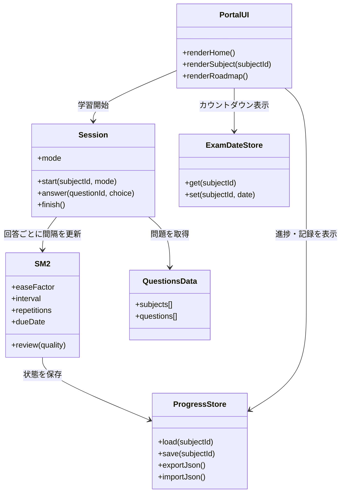
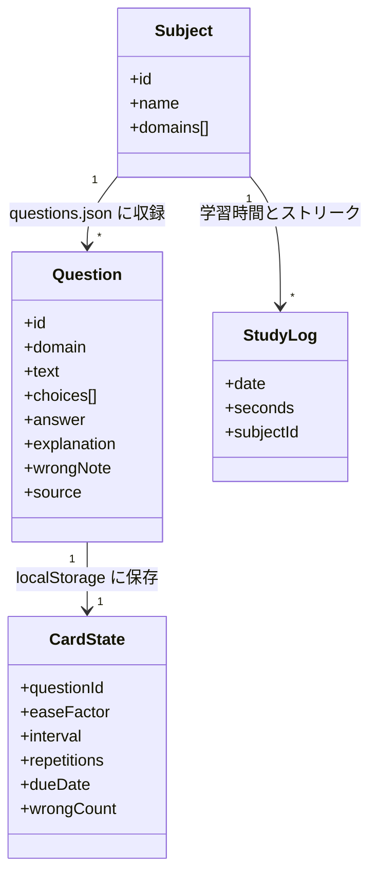

# システム構成図（UML）

資格勉強ポータルの構成を UML で表したもの。実体は GitHub Pages 上の静的 PWA で、サーバー側の処理やアカウントは持たない。学習データはすべて利用者のブラウザ（localStorage）に保存される。

## コンポーネント／クラス構成（クラス図）

## データモデル（questions.json と localStorage）

## 配置の要点

| 要素 | 実体 | 役割 |
|---|---|---|
| 配信 | GitHub Pages（リポジトリ main ブランチ） | 静的ホスティング、無料 |
| 画面 | index.html / style.css | iOS 風カード UI |
| ロジック | app.js | 画面遷移、4 つの学習モード、SM-2、統計 |
| データ | questions.json | 科目パック（GH-300 60 問／応用情報 30 問、全問オリジナル） |
| 永続化 | localStorage | `studyapp.progress.v2.<科目ID>`、`studyapp.examdate.v3.<科目ID>` |
| オフライン | sw.js（Service Worker、キャッシュ名 study-app-v3） | PWA としてオフライン動作 |
| 引っ越し | JSON エクスポート／インポート | 端末間の進捗移行（v1 形式も読込可） |
