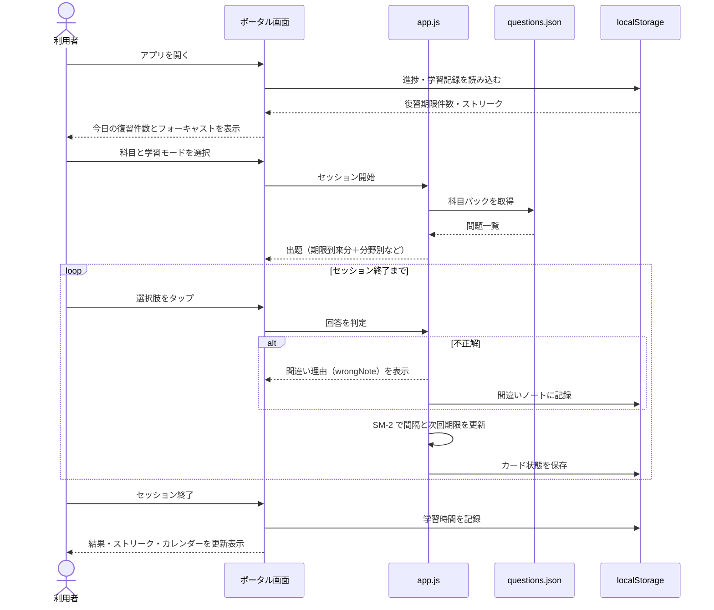
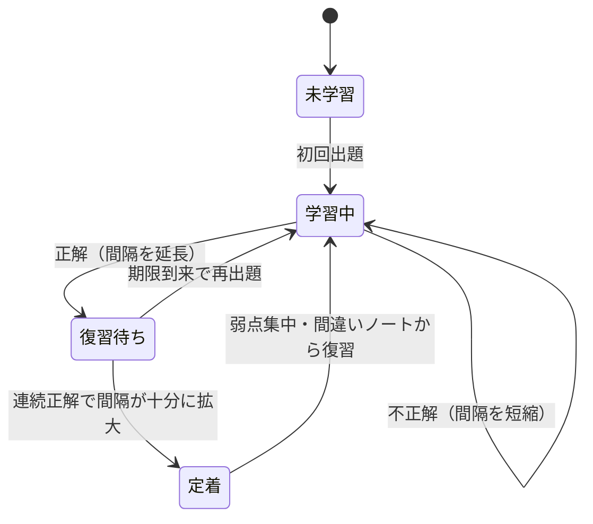

# ユーザーフロー（UML）

## 学習セッションの流れ（シーケンス図）

## 問題カードの状態遷移（状態遷移図）

## モード別の違い

| モード | 出題対象 | 採点タイミング | SM-2 への反映 |
|---|---|---|---|
| 通常学習 | 期限到来カード＋分野別ドリル | 即時 | あり |
| 弱点集中 | 間違い履歴・低 ease のカード（最大 20 問） | 即時 | あり |
| ランダムミニテスト | ランダム 10 問 | 最後に一括（タイマー付き） | なし（学習時間のみ記録） |
| フラッシュカード | カード形式で自己評価 | 自己申告 | あり |
